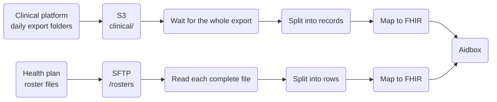
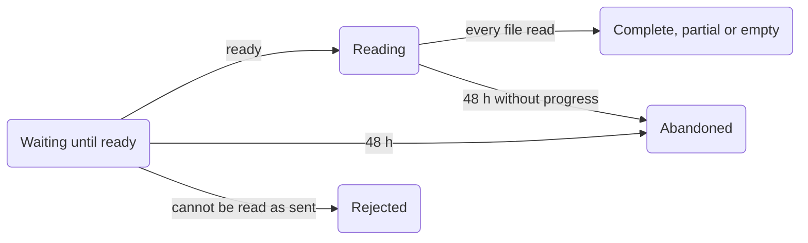

# Reading Files from Storage

Not every system sends data message by message. Many deliver it as files on a schedule: a clinical
platform exports a day of changes, a health plan drops a roster per network, a hospital system
sends report extracts twice a day. The files land in an SFTP directory or a cloud storage bucket,
and someone has to pick them up.

A file feed does that. Interbox watches a folder, waits until a file or a whole export is
complete, reads each file once and runs it through a [pipeline](../pipelines.md), the same as a
message from any other source.


Interbox only reads. It never writes, moves or deletes anything in the folder, so read access is
all it needs, and cleaning up old files stays with whoever owns the storage.




Each row is one **feed**: a folder with its own pipeline. Interbox reads the complete files,
splits them into records, and your mapping turns each record into FHIR resources.

Interbox reads feeds from [SFTP](sftp.md), [a local or mounted folder](local-folder.md), [Amazon S3](amazon-s3.md),
[Google Cloud Storage](google-cloud-storage.md) and [Azure Blob Storage](azure-blob-storage.md):



A directory on an SFTP server.


A folder on a volume mounted into Interbox, such as a network share.


An S3 bucket or an S3-compatible store.


A Cloud Storage bucket.


A Blob Storage container.



## Use cases

What a file feed is for, and how it handles each case:

| What arrives | How the feed handles it |
|---|---|
| A clinical platform sends a daily export as several NDJSON files in a new folder | The parts only make sense together, so Interbox **waits until the whole folder is there**. The sending system writes one small file into the folder last to say it is complete; that file can list the parts and their record counts, so a part cut short is caught. |
| A set of related CSV tables, such as members, providers and encounters, arrives together | The same: **one folder per set**, read once it is complete. |
| A health plan drops one roster CSV per provider network into a bucket, with names of its own choosing | Each file stands alone, so Interbox **reads it as soon as it has finished arriving**. |
| A hospital system sends report extracts twice a day, each a full snapshot | Only the newest snapshot of each report matters, so Interbox **reads that one and skips the older ones** that piled up. |
| A data warehouse sends pipe-delimited files every day | Each file stands alone and is read as **pipe-delimited text**. |
| A set of files that always has the same names, but no file that says it is complete | Interbox **waits until every expected file is there**. |

A file feed reads what is already in storage. Pulling an export out of a FHIR server through its
API is a job for something else, which can then write the export into storage for a feed to read.

## Set up the pipeline

This pipeline reads a nightly clinical export from S3 and loads it into Aidbox. Each export is a
folder of NDJSON files, one FHIR Bundle per line:

```ts
import { env } from "@health-samurai/interbox";
import { aidbox, fhirItems, skipUnchanged } from "@health-samurai/interbox/aidbox";
import { pipeline, postgresStore } from "@health-samurai/interbox/chain";
import type { Bundle, Resource } from "@health-samurai/interbox/fhir/4.0.1";
import { deliveryEnd, fileDropSource, ndjson, records, s3, unpack, type NdjsonRecord } from "@health-samurai/interbox/files";

const toAidbox = aidbox({
  url: env("AIDBOX_URL"),
  auth: { kind: "basic", user: env("AIDBOX_CLIENT_ID", "root"), password: env("AIDBOX_CLIENT_SECRET") },
});

function bundleToResources(row: NdjsonRecord): Resource[] {
  const bundle = row as unknown as Bundle;
  return (bundle.entry ?? []).flatMap((entry) => (entry.resource === undefined ? [] : [entry.resource]));
}

pipeline("clinical")
  .source(
    fileDropSource({
      transport: s3({ bucket: env("BUCKET"), prefix: "clinical" }),
    }),
  )
  .step(unpack())
  .step(ndjson())
  .store(postgresStore({ codec: "json" }))
  .step(deliveryEnd())
  .step(records(bundleToResources))
  .step(fhirItems())
  .step(skipUnchanged())
  .sender(toAidbox);
```

- `fileDropSource(…)` watches the feed. `transport` names the storage and where the feed is in
  it. Each export folder waits for its `_READY` file, which the sending system writes last (see
  [When a delivery is ready](#when-a-delivery-is-ready)).
- `unpack()` decompresses each `.gz` file, and opens a zip into its files.
- `ndjson()` splits a file into records, one per line, and skips a line that is not JSON.
- `.store(…)` keeps every record in Postgres, so a failed send is retried from there (see
  [Pipelines](../pipelines.md)).
- `deliveryEnd()` gives each delivery, an export folder or a single file, its verdict once its
  last file is read (see [What happens to a delivery](#what-happens-to-a-delivery)).
- `records(bundleToResources)` runs your mapping on each record. `bundleToResources` is your
  function, from a Bundle to the FHIR resources to write. `ndjson()` gives each record as an
  `NdjsonRecord`, a plain JSON object, so the function casts it to the FHIR type it expects.
  Mapping steps go after `deliveryEnd()`, which takes the delivery's end record out of the
  rows; `fhirItems()` does not accept that record.
- `fhirItems()` gives each resource its key and references, so Aidbox receives them in order.
- `skipUnchanged()` drops a resource whose content has not changed since it was last sent.
- `.sender(toAidbox)` writes the resources to Aidbox.

With full snapshots, most records repeat in every delivery; `skipUnchanged()` sends Aidbox only
what changed.

For CSV use `csvRows()` in place of `ndjson()`, with a mapping that takes a `CsvRecord`, and for
HL7v2 `hl7v2Messages()`, with a mapping that takes the message as a string. To read from another
storage, replace `s3(…)` with `sftp(…)`, `local(…)`, `gcs(…)` or `azure(…)`. Give each pipeline its own feed:
two pipelines must not read the same folder, or one inside another.

Every setting, with its default, is in [`fileDropSource`](../../reference/file-drop.md#filedropsource).

Give secrets as `env("…")` (see [Env and Config](../env-and-config.md)). Interbox refuses to
start the pipeline when a secret is a literal, or when an `env("…")` in the transport names a
variable that is not set and has no default.

## Deliveries

A feed is divided into **deliveries**, and Interbox reads each delivery once. By default each
top-level folder is one delivery, holding every file inside it:

```text
clinical/
├── 20261013T060000Z/              ← one delivery
│   ├── clinical_00001.ndjson.gz
│   └── clinical_00002.ndjson.gz
└── 20261014T060000Z/              ← the next delivery
    ├── clinical_00001.ndjson.gz
    └── clinical_00002.ndjson.gz
```

In a feed of loose files, each file is a delivery of its own, and a file the sending system rewrites is
read again as a new delivery:

```text
rosters/
├── roster_20261013.csv            ← one delivery
└── roster_20261014.csv            ← the next delivery
```

When the files do not fall into folders, such as a flat folder where a shared prefix ties
the files of one export together, a `group` function names each file's delivery, files at the
top level included (see [`group`](../../reference/file-drop.md#group)). A delivery `group` names
is ready by the same rules as a folder, unless it is a top-level file that `group` maps to its
own path.

## When a delivery is ready

A folder is ready once the sending system writes a **marker file** into it, last. The marker file is
called `_READY` unless you set `marker` to another name. Until it appears, Interbox waits, so a
folder whose files are still uploading is never read halfway.

A file at the top level of the feed is ready once it **has finished arriving**. On a cloud bucket
a file is visible only once its upload ends; on SFTP, a local folder and Azure, Interbox waits until the file
stops changing (see the storage's page).

The marker file can be empty, or list the files with their record counts so that a file cut short
is caught. Its format, and the rules the sending system follows, are in
[Sending Files to Interbox](sending-files.md).


[Sending Files to Interbox](sending-files.md)


### Expected files

A sending system that writes no marker file must always send the same set of names. List them
with `expect`, which takes the place of the marker file:

```ts
expect: ["members_*.csv", "providers_*.csv", "encounters_*.csv"],
```

The delivery is ready once each pattern matches a file and every file in it has finished
arriving. Name only the files that come every time: a pattern no file matches holds the delivery
until it is abandoned. Interbox refuses to start a pipeline that sets both `marker` and `expect`.


A pattern says that a kind of file is there, not how many. With `clinical_*.ndjson.gz`, a folder
is ready as soon as the first part arrives, and the parts still uploading are missed. When the
number of parts changes from one export to the next, the sending system must write a marker
file.


## Order and snapshots

Interbox reads deliveries in name order. Three settings change that:

- `ordered`: one delivery at a time, strictly in order, for changes that must be applied in
  sequence. A delivery that sorts before one Interbox has already started reading is rejected
  and reported, even if it was only waiting for its marker file.
- `latestOnly`: for full snapshots, Interbox reads only the newest delivery of each report and
  rejects the older ones (`superseded by <name>`). `ED_202610140600.csv` and `ED_202610141800.csv` are two
  snapshots of one report. While one snapshot of a report is being read, the others wait: none
  is read or rejected until it ends, and each one that is ready meanwhile is reported once,
  `held behind <name>, which is still reading`.
- `order`: for names that do not sort by time, such as `Census10142026.csv` with the date as
  month, day, year, a function gives the key to sort by.

[`fileDropSource`](../../reference/file-drop.md#filedropsource) has the details.

## Moving a feed from another reader

When another system has been reading the feed until now, Interbox does not know which deliveries
it already read, and would read them all again. The same holds after you rename the pipeline or
change its `group`. `startAfter` tells Interbox where to begin:

1. Stop the old reader, and let it finish the delivery it is reading.
2. Set `startAfter` to the name of the last delivery it read in full.
3. Start the pipeline.

Interbox never reads that delivery or any that sorts before it. When you are unsure which
delivery the old reader finished last, take the one before: Interbox then reads one delivery a
second time, which is safe when your pipeline gives each record the same id on every read. A
feed has one `startAfter`.

After a `group` change, set `startAfter` to the name the new `group` function gives the last
delivery read, not the folder name it had before. Interbox compares the value with delivery names
under the current `group`, so an old folder name closes the wrong deliveries, or none, and the
feed is read again.

```ts
fileDropSource({
  transport: s3({ bucket: env("BUCKET"), prefix: "clinical" }),
  startAfter: "20261014T060000Z",
});
```

## Reading a delivery as a whole

By default each file of a delivery is read on its own, and each record is a unit of the
pipeline. Some checks need the whole delivery at once: a header file and a lines file that
together make one record, one provider's rows spread over several files, or a full snapshot to
compare with the one before it. With `read: "delivery"`, Interbox stores the delivery's files
as received and commits the delivery as one unit; a step after the store opens the files, checks
them and splits them.

```ts
fileDropSource({
  transport: s3({ bucket: env("BUCKET"), prefix: "providers" }),
  read: "delivery",
});
```

A delivery is then stored whole or skipped whole: when Interbox cannot read one of its files, no
file of it is stored. Interbox copies the files as received into Postgres, with no limit on their
size, and a step after the store reads them as it needs. The copy has to finish within one poll,
`pollTerm`, 15 minutes by default.
[`read: "delivery"`](../../reference/file-drop.md#read-delivery) and
[Reading stored files](../../reference/file-drop.md#reading-stored-files) have the details.

## File formats

| File | Read by |
|---|---|
| `.ndjson` or `.jsonl`: one JSON object per line | `ndjson()` |
| `.csv` or `.txt`: delimited text | `csvRows()` |
| `.zip` of any of these | `unpack()`, then the step for its files |
| `.hl7`: an HL7v2 batch | `hl7v2Messages()` |
| any other name | your own step |

Any of them may be compressed with gzip (`.ndjson.gz`, `.csv.gz` and so on); `unpack()` opens it.
With `read: "file"`, Interbox reads files of up to 64 MiB as stored, so a `.gz` file counts at its compressed size.

`csvRows()` reads comma-separated UTF-8 with a header row. For pipe- or tab-delimited files, files
without a header, padded columns or another encoding, see its options in
[`csvRows()`](../../reference/file-drop.md#csvrows).

## What happens to a delivery



### Waiting

A folder delivery waits until it is ready, and stalls if it stops making progress while it is
read. A top-level file is never warned about or abandoned while it is still arriving.

| After | Interbox |
|---|---|
| `waitFor.warn`, 1 h | logs a warning |
| `waitFor.abandon`, 48 h | abandons the delivery and skips its unread files |
| `cadence`, if set, with no delivery finished reading | logs a warning that the feed went silent |

Time Interbox was stopped does not count against a delivery: a poll that starts more than
`pollTerm` plus the larger of `waitFor.warn` and two poll intervals after the previous one
starts every open delivery's clock again.

### Rejected deliveries

Interbox rejects a delivery, reads none of it and reports why. The reason is one of:

| Reason | When |
|---|---|
| `empty` | the delivery is ready but holds no data file |
| `marker repeated` | two marker files where one belongs |
| `marker inaccessible` | the marker file cannot be read |
| `marker malformed` | the marker file is neither empty nor a valid list of files |
| `marker paged` | the list is split over several marker files with `link` |
| `marker too large` | the marker file is larger than 1 MiB |
| `marker names a passed-over file: <name>` | the list names a file Interbox ignores, or the marker file itself |
| `order failed: …` | the feed's `order` function threw, with its message, or returned an empty key |
| `series failed: …` | the feed's `latestOnly` function threw, with its message, or returned an empty series |
| `named in the future` | with `ordered` or `latestOnly`, the name is a date and time more than an hour in the future, which points to a wrong clock or time zone at the sending system; on other feeds such a name is read like any other |
| `older than <name>` | with `ordered`, it sorts before a delivery Interbox has started reading, whether or not that delivery is finished |
| `superseded by <name>` | with `latestOnly`, a newer snapshot of the same report is ready or was read |
| `named before startAfter <name>` | it sorts at or before `startAfter` and appeared after `startAfter` was set; deliveries already there at that time are rejected without a report |

With `latestOnly`, Interbox also reports a ready delivery it holds back while another one of
the same report is being read, once, reason `held behind <name>, which is still reading`. The
held delivery is not rejected: Interbox reads it, or rejects it `superseded by <name>`, once that
one ends.

A report, like a skipped file, shows up as a skipped unit of the pipeline with its reason when
the pipeline starts with `unpack()`, and as a warning in the log otherwise.

### Verdicts

To know how each delivery went, add the [`deliveryEnd()`](../../reference/file-drop.md#deliveryend)
step to the pipeline. It gives each delivery that Interbox began reading one verdict once its last
file is read. A rejected delivery, or one abandoned before it was ready, gets no verdict; its
report says why. The verdict says how Interbox read the delivery, not what reached the destination.

| Verdict | Meaning |
|---|---|
| `complete` | Interbox read every file, and every count in the marker file matched, though your own steps skipped or dropped records or whole files |
| `partial` | Interbox skipped a file, a reading step such as `csvRows()` skipped a record or a file, or a count did not match; for a count, the verdict names each file with both counts. A skip made by a step of your own does not count |
| `empty` | no file of the delivery held a record, or your own steps dropped every file before reading it |
| `abandoned` | the delivery stalled while it was read, past `waitFor.abandon` |

## What Interbox does with a file

| Case | Interbox |
|---|---|
| reads the file in full | stores its records |
| cannot read one record: bad JSON, a wrong CSV field count, a record over the size limit | skips that record and reads on |
| finds the file over the feed's `maxFileBytes`, 64 MiB unless set (`over maxFileBytes`), a corrupt archive (`corrupt archive`), changed or removed mid-read (`version_changed`, `not_found`), or refused to it by the storage (`inaccessible`) | skips the file and reports why |
| cannot reach the storage, or the storage refuses its credentials | logs an error and tries again at the next poll (every 30 seconds by default), or later after a rejected SFTP login ([SFTP](sftp.md#setup)); it skips nothing |

A skipped file's reason ends with the version Interbox listed it at, such as
`over maxFileBytes, listed at <version>`, or with `unlisted` when the latest listing no longer
had it. A folder delivery that disappears from the storage while Interbox reads it is still
finished: each file not yet read is skipped, `not_found`, and the delivery gets its verdict.

A file overwritten while Interbox reads it is never stored half old, half new. On SFTP, and in a
local folder when the file is rewritten in place, Interbox drops what it read; on a bucket, or in
a local folder when a new file is renamed over it, Interbox may finish the old version and store that. A top-level file is
read again in its new version at the next poll. A file in a folder delivery that Interbox did not
finish reading is skipped, since a delivery must not change once it is ready.

A skip holds for that version of the file. To have it read, write a new version of a top-level
file, or put the file in a new folder. Skipped and failed records show up like any other
pipeline's, with the error kinds in [Errors](../errors.md).

## See also


[Sending Files to Interbox](sending-files.md)



[fileDropSource](../../reference/file-drop.md#filedropsource)



[Pipelines](../pipelines.md)

