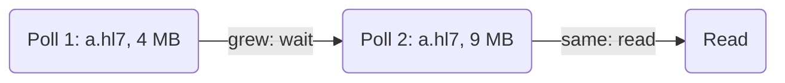

# Local and Mounted Folders

Sometimes the files are already on a disk that Interbox can see. Examples: a network share that
the platform mounts into the container (an Azure Files or NFS volume in Kubernetes, a CIFS mount on
a VM), or a host folder bound into a Docker container. `local(…)` reads such a folder as a feed. The
platform handles the mount; Interbox only reads files from a path.

## When Interbox reads a file

A file in a folder can be seen while the sending system is still writing it. Interbox reads a file
once its size, modification time and inode match across two polls, and it is at least
`minFileAge` old. A delivery's marker file follows the same rule.



Set `minFileAge` when a sending system can pause in the middle of a file for longer than
`pollInterval`. Also set it when the folder is a network mount, because the mount can keep showing
old attributes for a few seconds. The cleanest fix is for the sending system to write each file
under a temporary name and rename it when done. A file renamed over one that Interbox is reading
does not disturb the read: Interbox finishes the old file, and reads the new one at the next poll.

A few cases need care:

- **After a restart** every file waits one poll, since Interbox has no earlier listing to compare.
- **An empty file** waits until it is at least five minutes old, since some systems create a file
  empty and fill it later.
- **A file rewritten in place** while Interbox reads it is dropped and read again in its new
  version.
- **A file the file server holds locked**, such as one a Windows system is still writing to a
  share: Interbox leaves it for the next poll and reads the rest of the feed.
- **A subfolder Interbox cannot open**: Interbox reports it once and reads the rest of the feed. It
  does the same for a symbolic link, which it never follows, for any entry that is neither a file
  nor a folder, and for a name that is not valid UTF-8.

## Setup

Interbox reads with the permissions of the user its process runs as. That user needs read access
to the files and read and execute access to every folder of the feed. Mount the volume read-only:
Interbox never writes, renames or deletes a file.

`dir` must exist when a poll starts, and each poll fails with an error while it does not. A mount
point that exists while nothing is mounted on it looks like an empty folder, not a missing one. To
make a missing mount fail the poll, point `dir` at a folder **inside** the share, such as
`/mnt/inbound/lab`, not at the mount point itself.

In Kubernetes, mount the volume into the Interbox container:

```yaml
containers:
  - name: interbox
    volumeMounts:
      - name: inbound
        mountPath: /mnt/inbound
        readOnly: true
volumes:
  - name: inbound
    persistentVolumeClaim:
      claimName: inbound-share
```

With Docker Compose, bind the folder read-only: `- /srv/inbound:/mnt/inbound:ro`.

On a network mount, the file server and the mount options are in charge of sign-in, encryption and
signing, so set them up there; Interbox never sees them. Choose mount options that return an error
when the server stops answering, instead of waiting forever. For CIFS this is `soft`, the default;
for NFS, set `soft` with a `timeo`. Interbox gives up on a call after `timeout`, but a call stuck
in a hard mount keeps holding one of the engine's file threads until the server answers.

## Configuration

```ts
import { env } from "@health-samurai/interbox";
import { aidbox, fhirItems } from "@health-samurai/interbox/aidbox";
import { pipeline, postgresStore } from "@health-samurai/interbox/chain";
import { fileDropSource, hl7v2Messages, local, records } from "@health-samurai/interbox/files";
import { messageToResources } from "./mappers/lab-results";

const toAidbox = aidbox({
  url: env("AIDBOX_URL"),
  auth: { kind: "basic", user: env("AIDBOX_CLIENT_ID", "root"), password: env("AIDBOX_CLIENT_SECRET") },
});

pipeline("labs")
  .source(fileDropSource({ transport: local({ dir: "/mnt/inbound/lab", minFileAge: "30s" }) }))
  .step(hl7v2Messages())
  .store(postgresStore({ codec: "text" }))
  .step(records(messageToResources))
  .step(fhirItems())
  .sender(toAidbox);
```

`hl7v2Messages()` gives each message as a string. `messageToResources` is your mapping, from one
HL7v2 message to the FHIR resources to write.

| Field | Required | Default | Sets |
|---|---|---|---|
| `dir` | yes | | the feed folder, as an absolute path inside the Interbox container; may be `env("…")` |
| `timeout` | | `30s` | the longest Interbox waits for any one filesystem call |
| `minFileAge` | | `0s` | how old a file must be before Interbox reads it |

The dashboard shows the feed as `file:///mnt/inbound/lab`.

Deliveries, file formats and pipeline settings shared by every storage are on
[Reading Files from Storage](README.md).
