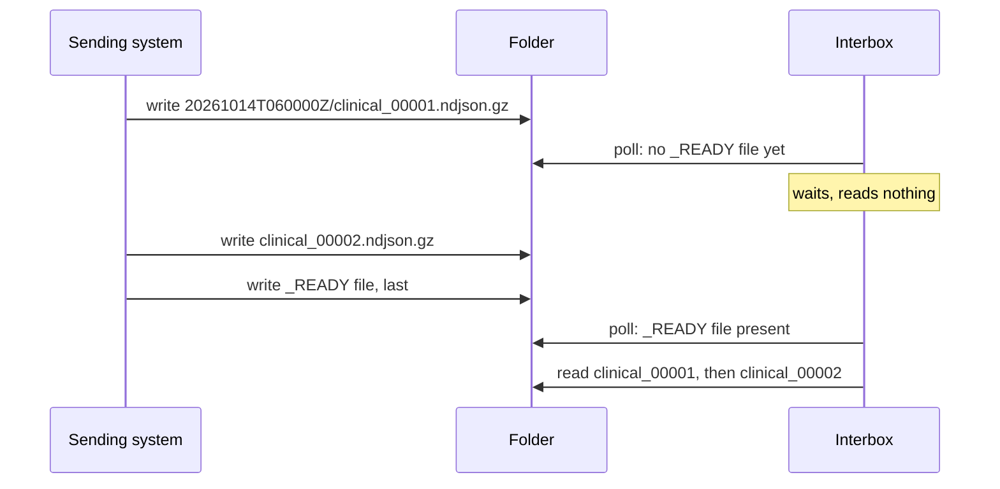

# Sending Files to Interbox

A sending system writes files into a folder on an SFTP server or in a cloud storage bucket, and
Interbox reads them from there. Interbox only reads: it never writes, moves or deletes anything in
the folder. This page lists what the sending system does so that every file and every export is
read whole.

The sending system needs to know two settings of the feed:

- the folder, or the bucket and prefix, the files go to;
- the name of the marker file, `_READY` by default, or the set of file names the feed expects in
  its place.

Interbox reads files of up to 64 MiB as stored. A feed that reads whole deliveries
(`read: "delivery"`) has no limit on file size.

## Folders or single files

- **An export made of several files**, such as a day of changes split into parts, goes into a new
  folder of its own, with the marker file written last.
- **A file that stands alone**, such as one roster, goes at the top level of the folder. It needs
  no marker file: Interbox reads it once it has finished arriving.

```text
<folder>/
├── 20261014T060000Z/              ← an export: read once _READY is there
│   ├── clinical_00001.ndjson.gz
│   ├── clinical_00002.ndjson.gz
│   └── _READY                     ← written last
└── roster_20261014.csv            ← a single file: read once complete
```

## The marker file

The marker file tells Interbox that an export folder is complete. Until it appears, Interbox
leaves the folder alone, however many files are already there, so a folder still uploading is
never read halfway. Write it directly in the export folder: a file of that name in a subfolder is
not the marker and is not read. Two marker files where one belongs reject the folder.



Write it in one of two forms.

**Empty.** Interbox reads every data file in the folder. Use it when the sending system cannot
count its records.

**A list of files**, in the shape of a [FHIR Bulk Data](https://hl7.org/fhir/uv/bulkdata/)
manifest. Interbox waits for every file the list names, and at the end compares each `count` with
the records it read, so a file cut short is caught:

```json
{
  "output": [
    { "url": "clinical_00001.ndjson.gz", "count": 48000 },
    { "url": "clinical_00002.ndjson.gz", "count": 12417 }
  ]
}
```

- `url`: a file name in the folder, a path relative to the marker file's folder, or a URL whose
  path ends with one. When the feed gathers files into a delivery with `group`, a name not found
  beside the marker file is looked for from the top of the feed, so a marker file at
  `12345/_READY` can list `12345_Patient.ndjson`.
- `count` (optional): every record written to the file.
- A sending system that has no counts can name the files in a shorter form, `files`, in place of
  `output`: `{ "files": ["clinical_00001.ndjson.gz", "clinical_00002.ndjson.gz"] }`. Each entry is
  a `url` as above. A marker file with both `output` and `files` is rejected.
- Files under `deleted` take the same entries and are read as data, like those under `output`.
- Interbox ignores every other field, `error` included.
- A list split over several marker files with `link` is rejected: write one list per folder.
- A list that names a file Interbox ignores (see [Rules](#rules)), or the marker file itself, is
  rejected.
- A file in the folder that the list does not name under `output`, `files` or `deleted` is reported, reason
  `not named by the marker`, and not read.


Interbox rejects the folder when the marker file is larger than 1 MiB, cannot be read, or is
neither empty nor one of these JSON forms.


### Without a marker file

A sending system that cannot write a marker file must always send the same set of names, such as
`members_*.csv` and `encounters_*.csv`. The feed lists them with `expect`, and Interbox reads a folder
once each name is there and every file in it is complete. Put every file of the folder in place
before the last expected one appears.


A set of names says that a kind of file is there, not how many. If the number of parts changes
from one export to the next, the sending system must write a marker file.


## Rules

1. Write each file in full. Write the marker file last, as a separate operation.
2. Upload under a temporary name and rename when done. Interbox ignores names that, in the
   feed and inside a zip:
   - end with `.part`, `.filepart` or `.tmp`;
   - start with `.`;
   - are `_SUCCESS`, unless it is the feed's marker file.
3. Never reuse a folder name. Leave a folder alone once it is ready.
4. To send data again, put it in a new folder, or write a new version of a top-level file.
5. Keep each file at or under 64 MiB as stored, unless the feed reads whole deliveries. Split a
   larger export into several files.
6. When the feed reads deliveries strictly in order (`ordered`) or reads only the newest snapshot
   (`latestOnly`), name folders and files so they sort in the order they were made, such as
   `20261014T060000Z`. With `ordered`, also finish each folder, its marker file included, in that
   order: a folder finished after Interbox has started reading a later one is rejected. Put a
   date and time in a name in UTC, marked `Z`: with either option, a name more than an hour
   ahead of Interbox's clock is rejected, reason `named in the future`. Without either option a
   name is never judged by its date.
7. Delete old files and folders once they are no longer needed. Interbox lists them on every poll.

## File formats

| File | Content |
|---|---|
| `.ndjson` or `.jsonl` | one JSON object per line |
| `.csv` or `.txt` | delimited text; the delimiter, the header row and the encoding are set per feed |
| `.hl7` | an HL7v2 batch |
| `.zip` | any of these |

Any of them may be compressed with gzip: `.ndjson.gz`, `.csv.gz` and so on. A file an upload tool
compresses on the fly (`Content-Encoding: gzip`) is stored as gzip, so it needs a `.gz` name.


Prefer gzip: it ends with a checksum, so Interbox spots a file cut short in transfer. A plain text
file cut at a line break looks complete; a marker file with record counts catches it.


## See also


[Reading Files from Storage](README.md)

