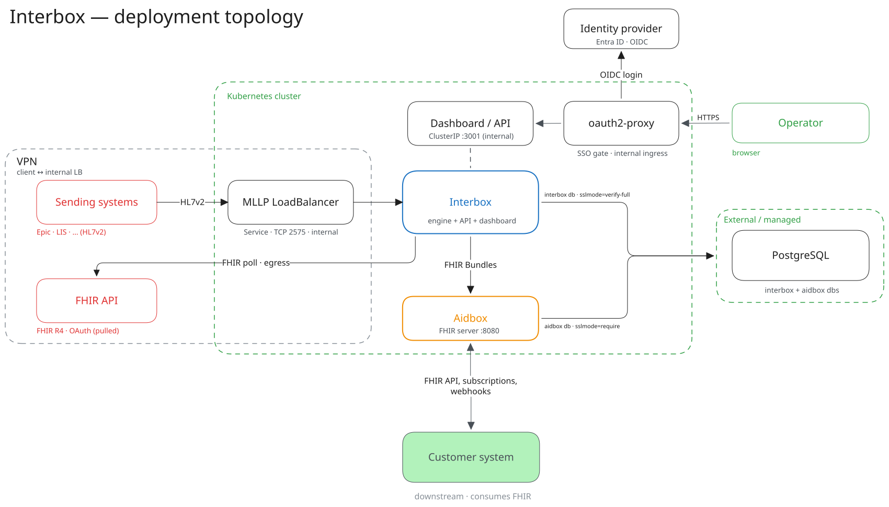

# Deployment

Interbox ships as one all-in-one image (engine + API + dashboard). It always
needs a **PostgreSQL** database, which it does **not** bundle. An **Aidbox**
endpoint is optional: you need one only when your pipelines deliver to it (see
[System Requirements](sizing.md) for sizing).



*Editable source: [`interbox-topology.excalidraw`](../../assets/interbox-topology.excalidraw) — open it at [excalidraw.com](https://excalidraw.com) to update the diagram, then re-export the PNG.*

Two supported ways to run it:

- **Docker Compose** — the fastest path for a single host or evaluation. The
  workspace template's `docker-compose.yaml` brings up Interbox, Postgres, and
  Aidbox together; see [Getting Started](../getting-started.md).
- **Kubernetes (Helm)** — the production path.

## Kubernetes (Helm)

The chart lives in [`HealthSamurai/helm-charts`](https://github.com/HealthSamurai/helm-charts)
(`interbox/` directory), and **its own docs are the source of truth** — kept
current with the chart. This page does **not** re-document values, secret keys,
or per-cloud overlays; go there for the reference:

- [**Chart README**](https://github.com/HealthSamurai/helm-charts/tree/main/interbox) —
  the full values table, install command, and setup scenarios (managed PG,
  reusing Aidbox's cluster, sibling charts, locked-down PG).
- [**PREREQUISITES.md**](https://github.com/HealthSamurai/helm-charts/blob/main/interbox/PREREQUISITES.md) —
  Postgres and optional Aidbox requirements, the workspace and sign-in settings,
  the secret keys, TLS, and MLLP exposure.

The one-liner to get going:

```console
helm repo add healthsamurai https://healthsamurai.github.io/helm-charts
helm upgrade --install interbox healthsamurai/interbox \
  --namespace interbox --create-namespace \
  --values values.yaml
```

## Running multiple replicas

Use a coordinated engine release, a compatible chain workspace and a chart
supporting per-probe paths, pod identity and ConfigMap snapshots. Complete the
[first coordinated upgrade](updating.md#first-upgrade-to-coordinated-runtime-generations)
before increasing `replicaCount`.

- Share one database, desired workspace revision and
  [business configuration](workspace.md#configuration-across-replicas).
- Use direct or session-pooled PostgreSQL connections. Coordination uses
  session locks, so transaction pooling is unsupported.
- Give each pod a separate writable [cache](workspace.md#cache-and-disk) and
  set `INTERBOX_WORKSPACE_INSTANCE` to its `metadata.uid`. Its engine and API
  must share that identity, cache and PID namespace.
- Route traffic only to ready pods. Sending systems must reconnect when a
  listener drains, and retry a webhook answered `503` while its pod stops.
  Every pod binds the webhook ports. Polling sources have one owner; custom
  listeners can run on each pod. Review [source ownership](../concepts/pipelines.md#your-own-source).
- Use an [ordered store](../concepts/stages.md#where-a-step-runs) for mapping
  that depends on earlier units' state. Separate pipelines writing the same
  resource need their own ordering contract.
- Set `versionGuard: true` on each Aidbox sender, give its client read and
  write permissions, and use a destination that enforces version preconditions;
  see [guarded Aidbox writes](../reference/steps.md#guarded-aidbox-writes).
  Custom senders and actions need destination idempotency for retries; see
  [senders](../concepts/stages.md#senders).
- Budget license slots, database connections and destination capacity for all
  overlapping pods, including rollout surge.

Coordinated rolling updates wait for old workers and actions to finish. A
missing pod can block the transition until its termination is confirmed;
follow the [operator procedure](local-testing.md#a-cutover-blocked-by-a-missing-pod).

An engine that loses its coordination session to the database reports unready
at once and keeps its workers running while it reconnects. After 10 seconds
without coordination it stops them, and starts them again once the database
returns.

## What's different about deploying Interbox

Use `/api/health` for startup and liveness: it checks the API process.
Set `probe.readiness.path: /api/ready` in a chart supporting per-probe paths.
Readiness also requires valid authentication configuration and a ready local
engine: its database, workers and runtime must be available. A pod with invalid
sign-in settings therefore leaves the MLLP Service too; see
[when it is misconfigured](secure-access.md#when-it-is-misconfigured-the-engine-keeps-running).
During startup or drain, health can stay `200` while readiness rejects traffic.
This lets the pod finish preparation or recovery without a liveness restart loop.

The chart's defaults encode a few things that are unusual for a web app and easy
to get wrong if you treat Interbox like a generic stateless service. These come
from how the engine works, so they are documented here rather than in the chart:

- **MLLP is raw TCP, so it gets its own LoadBalancer** — HTTP ingress can't carry
  it. It's meant to be a *private* LB reached over a VPN/VNet. **Pin its IP**: a
  dynamic LB address can change on reinstall and break the firewall/VPN rules the
  sending hospital built around it. That stable address is the one networking
  detail worth agreeing with DevOps up front.
- **The dashboard is internal-only.** It's a `ClusterIP` — reach it with a
  port-forward, or an *internal* ingress class for a stable hostname. Never
  expose it publicly.
- **The pod builds the workspace on boot** (clone + `bun install` + `Bun.build`).
  That makes boot memory-hungry, so don't set a tight memory limit — a tight one
  OOM-kills the pod during startup. The chart's startup probe is deliberately
  generous to cover it.
- **Migrations run on boot.** An upgrade is just a new image tag; the pod
  migrates the database as it comes up. A shared session lock serializes engine
  and workspace migrations across replicas. The engine also self-creates its
  `interbox` database when the `DATABASE_URL` user has `CREATEDB` (otherwise
  pre-create it — see PREREQUISITES). A database that already exists is used as
  it is. On Databricks Lakebase the engine logs in as a service principal: see
  [Databricks Lakebase](lakebase.md).

How the pod gets that workspace — which branch it tracks, how pipeline changes
reach a running engine, and what the dashboard is allowed to change — is
[The Workspace](workspace.md). Every host the pod connects to, for writing egress
rules, is in [Network Access](network.md).
